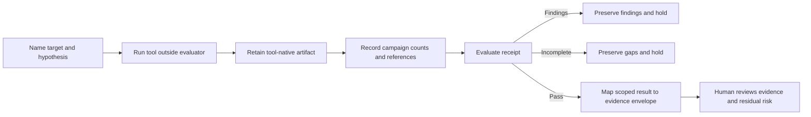

# Adversarial Software Assurance

Use adversarial testing on selected logic where examples alone leave material
uncertainty. Choose the method from the failure hypothesis, target a named
boundary, retain the tool-native artifacts, and report every survivor,
counterexample, crash, hang, skipped case, timeout, tool failure, and
unavailable tool.

## Method selection

| Method | Use it to test | A finding means |
| --- | --- | --- |
| Property testing | Invariants across generated inputs and state transitions | A reproducible counterexample violated the named property |
| Mutation testing | Whether the existing tests detect controlled code changes | One or more mutants survived, timed out, or lacked coverage |
| Fuzzing | Parser, protocol, file, API, and untrusted-input behavior | A crash, hang, sanitizer result, or other retained failure occurred |

Line coverage does not replace these methods. A passing campaign supports only
the named target, properties, mutation operators, input corpus, budgets, tool
version, and revision.

## Receipt flow



The evaluator does not install or run testing tools. Populate an
`ai-safe2.adversarial-assurance-receipt.v1` document from the native results,
then run:

```bash
python developer-workflow/scripts/evaluate_adversarial_assurance.py \
  --receipt adversarial-receipt.json \
  --schema developer-workflow/schemas/adversarial-assurance-receipt-v1.schema.json \
  --output evaluated-adversarial-receipt.json
```

A required method is satisfied only when at least one matching campaign
produced results, attempted and completed at least one case, reported no
findings, and reported no skipped or timed-out cases. A produced campaign with
findings remains produced execution, but the assurance conclusion is
`findings`, not `pass`. An unavailable or failed tool produces an `incomplete`
conclusion.

## Evidence mapping

Map `pass` to a narrowly named capability such as
`parser-adversarial-assurance`. Keep the exact revision, target, method, tool
and version, counts, limitations, and native artifact references in the
evidence envelope. Do not map `findings` or `incomplete` to the required pass
capability. Attach the envelope through the evidence bridge only after its
canonical digest is calculated.

This receipt does not prove defect absence, security, framework conformance,
merge readiness, or release readiness. It cannot accept a surviving mutant or
other residual risk.
