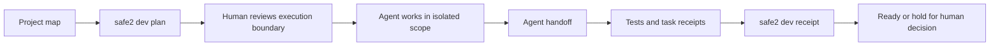

# Bounded Agent Execution

Use an execution boundary after `safe2 dev plan` and before an agent changes
the repository. Use a handoff after the agent stops. These contracts add tool,
skill, concurrency, context, and handoff controls without replacing the CLI's
development plan or task receipts.

## Execution sequence



## Before work begins

Create an `ai-safe2.agent-execution-boundary.v1` document that names:

- the CLI development plan and exact starting revision;
- the accountable human and executor;
- included and excluded paths;
- branch, worktree, or read-only isolation;
- each allowed tool, permission, data boundary, secret requirement, and reason;
- each external skill, its source, immutable pin, license, scan evidence,
  admission decision, and human decision owner;
- parallel-worker, subagent-depth, elapsed-time, and tool-call limits;
- concrete stop or escalation conditions;
- authority that remains prohibited.

An admitted skill requires produced AI SAFE2 skill-gate evidence and a named
decision owner. External SkillSpector evidence may add another attributed
review, but it does not replace the native gate or human admission decision.

Suggested skill review commands:

```bash
safe2 scan skill PATH
safe2 gate skill PATH
```

Record SkillSpector output through the existing
`safe2.skillspector-evidence.v1` contract when that optional reviewer is used.
`unavailable`, `failed`, and `not_requested` do not become produced evidence.

## During execution

- Give each worker that can write a separate worktree or non-overlapping path
  scope.
- Do not let a worker add tools, skills, secrets, network access, subagents, or
  time beyond the authorized boundary.
- Stop or escalate when a declared condition fires.
- Treat shared-source agent agreement as correlated output, not independent
  review.
- Start a new boundary when the task, revision, owner, scope, or authority
  changes materially.

The context budget is expressed through bounded elapsed time, tool calls,
parallel workers, and subagent depth. Model token limits vary by provider and
do not prove that the active context is accurate or complete.

## Handoff

The executor produces an `ai-safe2.agent-handoff.v1` document containing:

- exact boundary, task, starting revision, resulting revision, and executor
  identifiers;
- completed, partial, blocked, or failed status;
- changed paths and admitted skills used;
- evidence references, findings, assumptions, unknowns, and conflicts;
- residual risks and triggered stop conditions;
- one concrete next action;
- explicit absence of completion, merge, release, deployment, and risk authority.

Validate the pair:

```bash
python developer-workflow/scripts/validate_agent_handoff.py \
  --boundary execution-boundary.json \
  --handoff agent-handoff.json \
  --schemas developer-workflow/schemas
```

The validator checks identity, the starting revision, admitted skills,
normalized relative changed paths, scope, and stop-condition consistency. The
resulting revision identifies what the executor produced; it is not required to
match the starting revision. A valid handoff is still an executor-produced
claim. Tests, scanner results, task receipts, review evidence, and the final
human decision remain separate.
