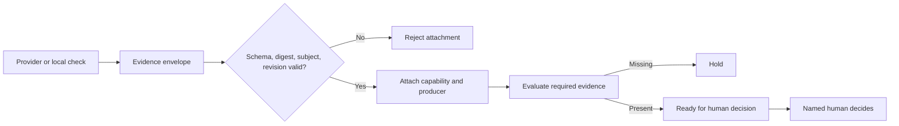

# Evidence Bridge and Review Provenance

The evidence bridge attaches validated evidence envelopes to the decision
record for the same subject and revision. It preserves `not_requested`,
`unavailable`, `failed`, and `produced` as different states. It does not run a
provider, evaluate the evidence, approve a change, or authorize an action.

## Sequence



Attach one or more envelopes:

```bash
python developer-workflow/scripts/attach_evidence.py \
  --record decision-record.json \
  --envelope evidence/targeted-tests.json \
  --envelope evidence/semantic-review.json \
  --evidence-schema developer-workflow/schemas/evidence-envelope-v1.schema.json \
  --decision-schema developer-workflow/schemas/decision-record-v1.schema.json \
  --output decision-record-with-evidence.json
```

Then run the existing deterministic evaluator:

```bash
python developer-workflow/scripts/evaluate_decision.py \
  --record decision-record-with-evidence.json \
  --output evaluated-decision-record.json
```

The bridge verifies the canonical digest defined in `CONTRACTS.md`. The digest
detects changed content. It does not authenticate the producer; unsigned
evidence remains unsigned.

## Review provenance

Use `ai-safe2.review-provenance.v1` beside a review evidence envelope. Record:

- the exact subject revision and reviewed scope;
- human, model, deterministic-tool, or hybrid producer identity;
- provider, model family, and operator when known;
- context, prior reviews, and implementation evidence visible to the reviewer;
- whether the reviewer was the change author, a different actor, mixed, or
  unknown;
- known provider, model, prompt, context, evidence, operator, or organization
  overlap;
- who assessed separation, the basis, and limitations.

The strongest status in this contract is `separation_observed`. That means the
record contains evidence of separation for the named dimensions. It does not
claim statistically independent assurance. Use `correlated` when a known
overlap could couple the outputs. Use `not_assessed` when the facts are absent.

For a human review, record the reviewer identity only when policy permits it.
`CODEOWNERS`, a requested review, or a green wrapper does not prove that a
human reviewed the exact revision. For an AI review, a different product name
does not prove a different provider, model family, prompt, context, or evidence
source.
